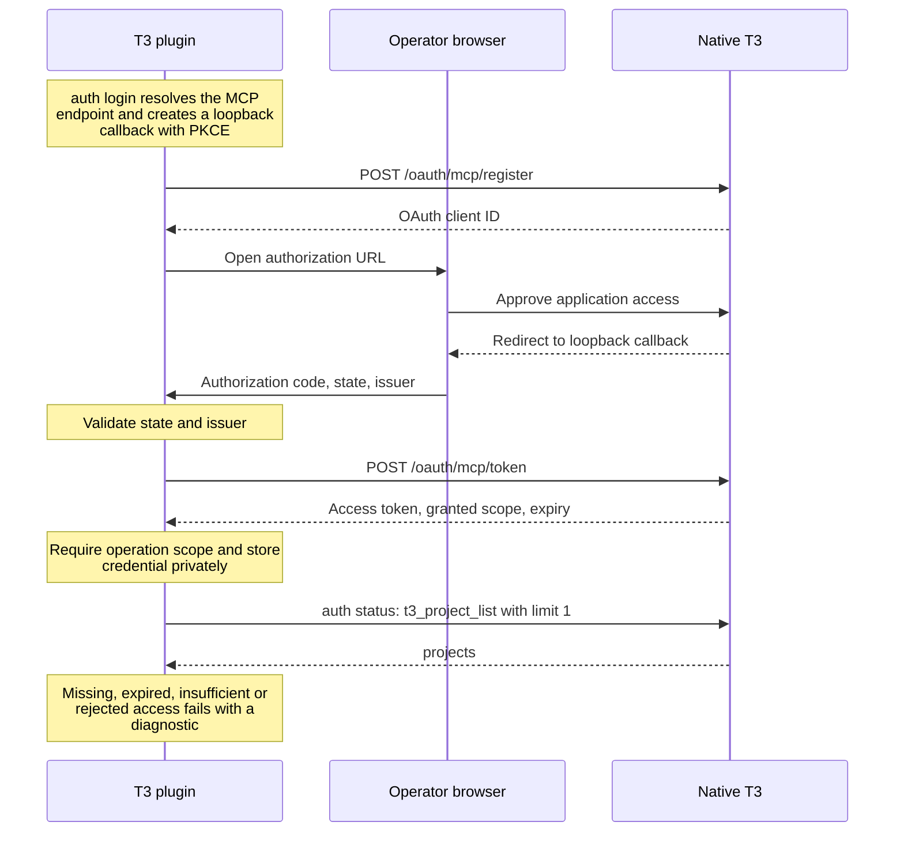
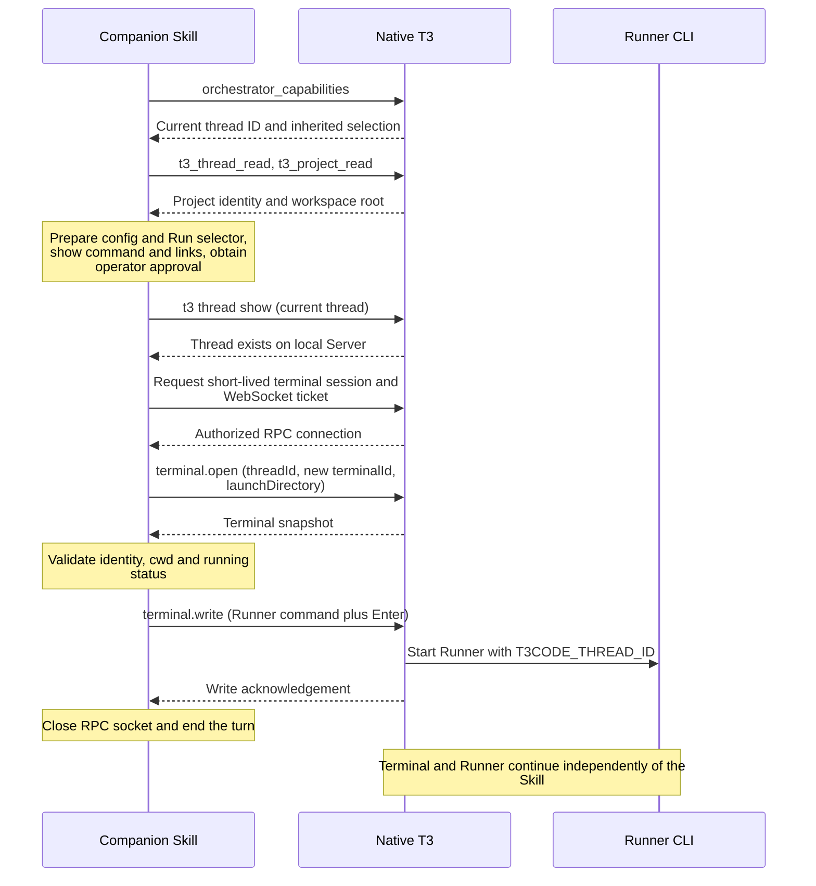
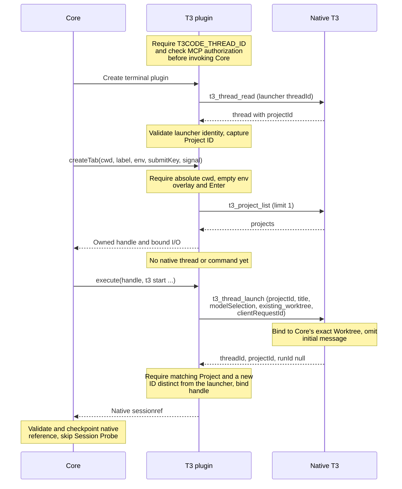
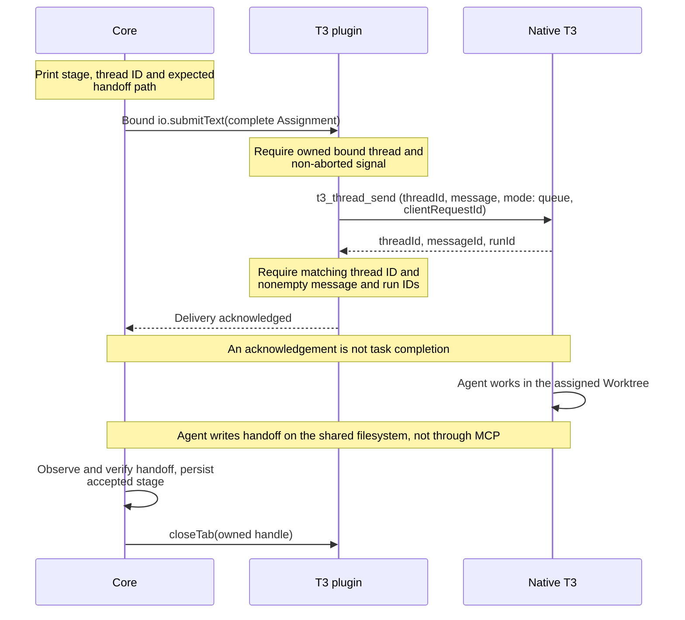
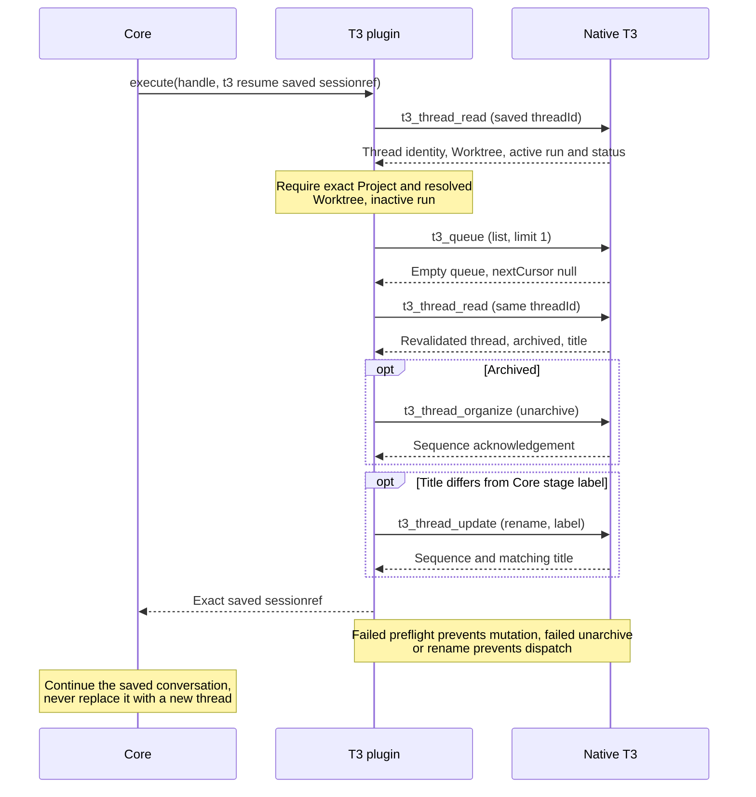
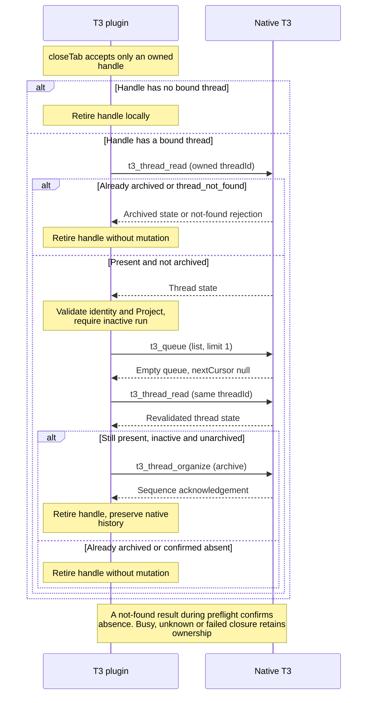
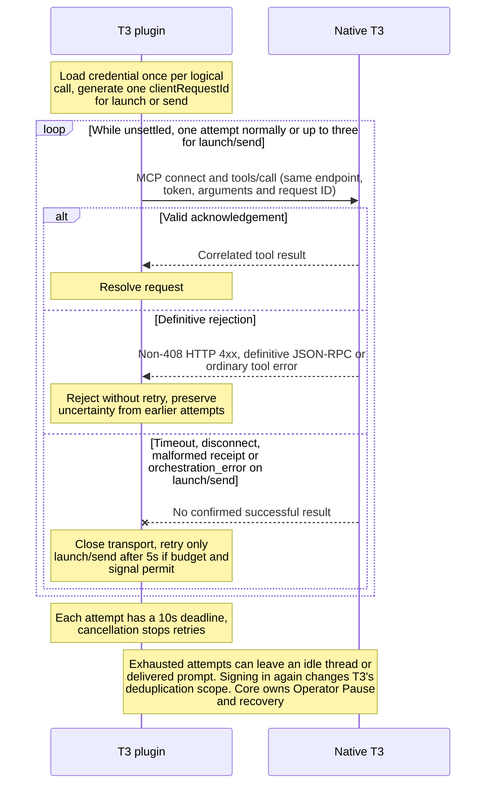

# T3 Code protocol

## Native interfaces used

The T3 plugin targets [T3 Code](https://github.com/pingdotgg/t3code) v0.1.11 and implements [Core's terminal contract](https://github.com/BuddyLabsCo/issue-runner-core/blob/main/docs/terminal-contract.md) v2 using native T3 chat threads. The companion Skill separately uses T3's terminal RPC to launch Runner itself. This document describes the implementation, not live acceptance results.

### Task adapter

| MCP tool | Parameters used | Purpose |
| --- | --- | --- |
| `t3_project_list` | `limit: 1` | Check authorization with an authenticated read |
| `t3_thread_read` | `threadId` | Resolve the launcher's Project and verify saved or owned thread identities and state |
| `t3_thread_launch` | `projectId`, `title`, `modelSelection`, `workspaceStrategy`, `clientRequestId` | Create an idle task thread in the existing Core Worktree |
| `t3_thread_send` | `threadId`, `message`, `mode: "queue"`, `clientRequestId` | Submit the complete Assignment prompt |
| `t3_thread_send` | `threadId`, `message`, `mode: "queue"`, `clientRequestId` | Queue diagnostic advice in the launcher Thread |
| `t3_queue` | `threadId`, `action: "list"`, `limit: 1` | Check for queued turns before resume or archival |
| `t3_thread_organize` | `threadId`, `action: "unarchive"` or `"archive"` | Reopen or archive a task thread without deleting its history |
| `t3_thread_update` | `threadId`, `action: "rename"`, `title` | Update the saved thread's title to the current Core stage label |

The plugin uses the [T3 MCP tool contracts](https://github.com/pingdotgg/t3code/blob/main/packages/contracts/src/orchestratorMcp.ts) over Streamable HTTP JSON-RPC. The endpoint defaults to `http://127.0.0.1:3773/mcp`; `terminalPlugins.mcpUrl` overrides it. Each attempt creates an MCP client, negotiates the connection, sends `tools/call`, and closes the transport. The adapter reads `structuredContent` or parses the first text result as JSON.

Runner signs in through T3's [external MCP authorization](https://github.com/pingdotgg/t3code/blob/main/docs/user/outside-agents.md) with OAuth authorization code and PKCE. It requests `orchestration:read` and `orchestration:operate`, stores the granted token, scope and expiry privately under `~/.issue-runner-t3`, and checks them before each logical MCP call. The file key is the SHA-256 of the normalized endpoint URL. Runner does not refresh expired credentials.

`createTab` returns an opaque handle and bound I/O without creating a native thread. The plugin interprets `t3 start --provider <instance-id> --model <model> [--option <id>=<value>]` and `t3 resume {sessionref}` itself. Start maps to `modelSelection: {instanceId, model, options: [{id, value}]}` and `workspaceStrategy: {type: "existing_worktree", worktreePath: cwd}`. The native thread ID becomes Core's `sessionref`; screen reads and key chords are unsupported. Core discovers the bundled Enhancement from the `issue-runner-agent-t3` package root when an Agent uses `agent: t3`. The Enhancement uses the bound Tab I/O to return the exact native thread ID without a readiness probe.

The Enhancement polls the owned Thread with `t3_thread_read` every 5s, or after 10s when observation fails. It tracks Run ownership across Assignment replacements and adopts the latest in-progress Run. For `completed` or `interrupted`, it uses `beforePosition` to find the last assistant message of the current Assignment's latest Run and `itemId` and `textOffset` to read its complete text.

If the reply starts with `[action required]` after leading whitespace and the expected handoff is absent, the Enhancement requests a pause from Core once per Run and Item. It continues observing the Thread and handoff while paused. Only Runner Enter releases an active pause; native questions and approvals stay in T3. Core invalidates confirmations on Assignment completion or replacement, and the Enhancement clears local pause state on replacement or Tab cleanup.

Resume and archival require `activeRunId: null` and status `idle`, `completed`, `failed`, `cancelled`, `interrupted` or `rolled_back`, unless archival is already complete. Identity and queue checks are preflight checks, not atomic with mutations.

### Skill launcher

| Native interface | Parameters used | Purpose |
| --- | --- | --- |
| `orchestrator_capabilities` | Current calling thread | Read the invoking thread ID and inherited provider/model/options |
| `t3_project_read` | `projectId` | Resolve the T3 Project's workspace root |
| `t3 thread show` | Current thread ID | Verify that the thread exists on the local Server |
| `t3 auth session issue` | `terminal:operate`, TTL 5m | Obtain a short-lived terminal credential after operator approval |
| `POST /api/auth/websocket-ticket/rpc` | Authorized terminal credential | Obtain the ticket for a separate authenticated RPC connection |
| `terminal.open` | `threadId`, new `terminalId`, `cwd`, `stopOnSettle: false` | Open the Runner terminal in the current conversation |
| `terminal.write` | `threadId`, `terminalId`, Runner command plus Enter | Start Runner in that terminal |

The [native RPC contract](https://github.com/pingdotgg/t3code/blob/main/packages/contracts/src/rpc.ts) uses JSON messages over WebSocket. Requests contain `{_tag: "Request", id, tag, payload, headers}`; success requires a correlated `Exit` with a `Success` result. The launcher resolves the local Server from its runtime record and keeps its separate terminal credential in memory. Each request waits up to 10s. It verifies the terminal identity, running status and working directory before sending the command once. Closing the socket leaves the terminal running; the client controls panel visibility.

## Interaction sequences

### Authorize Runner

### Launch Runner from the companion Skill

### Initialize and create a task thread

### Submit a task and verify completion

### Resume an exact native thread

### Archive an owned task thread or confirm absence

### Settle requests and handle lost replies

