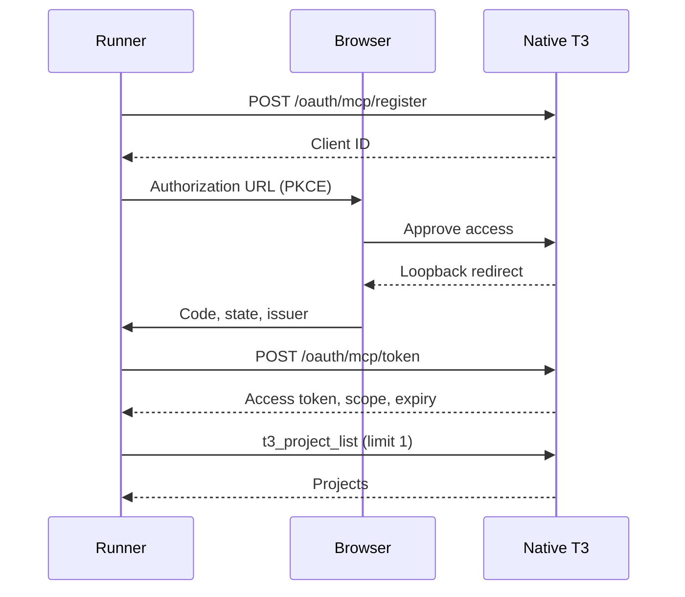
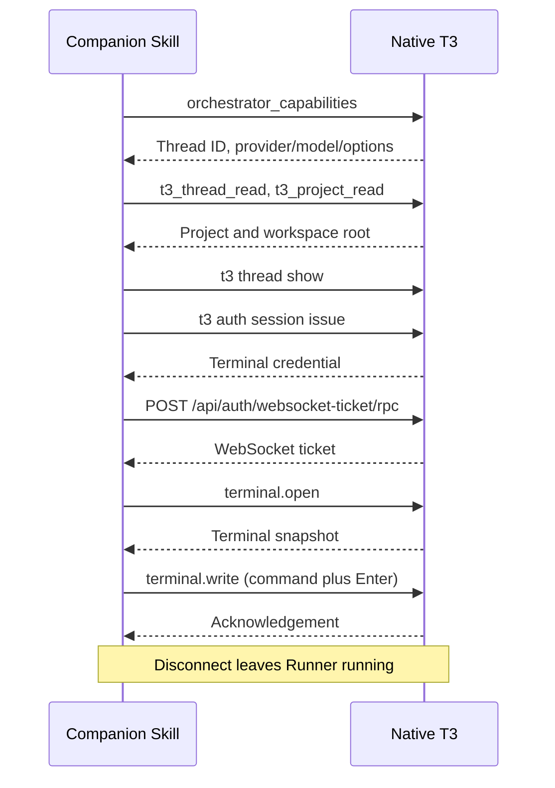
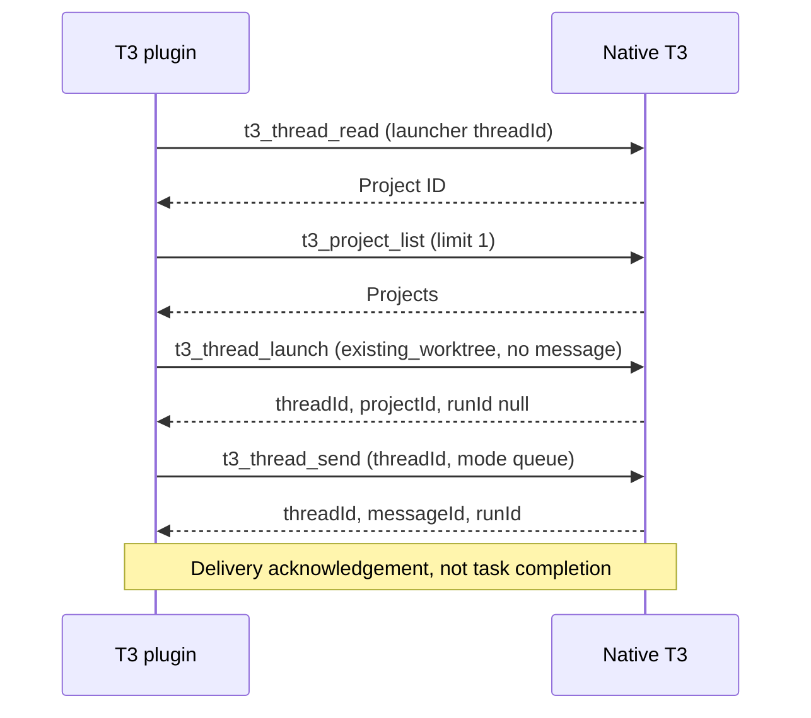
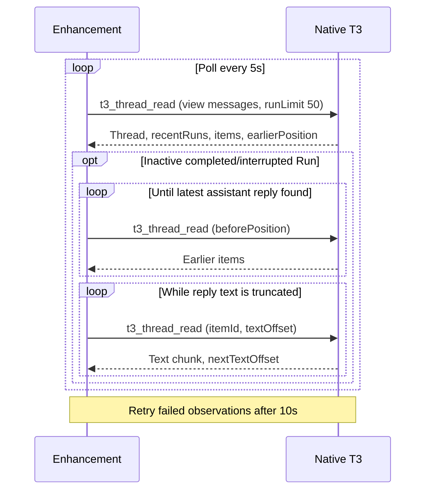
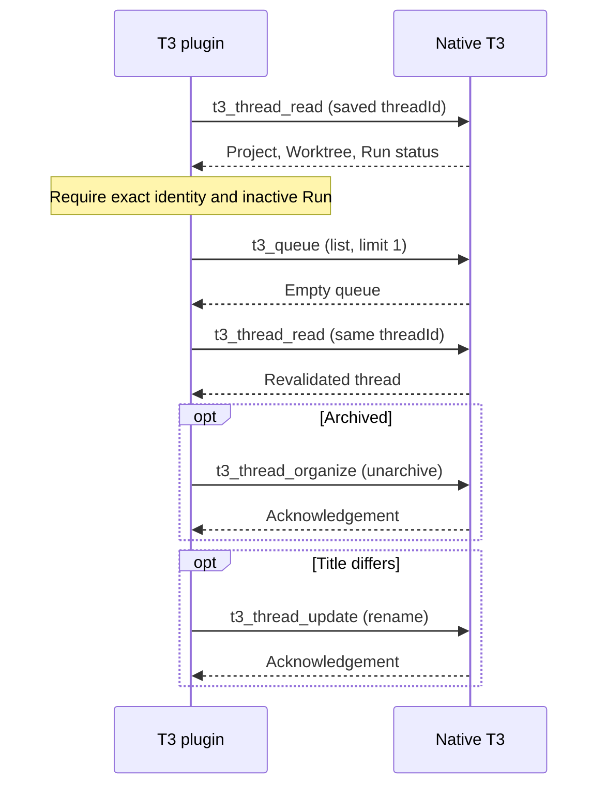
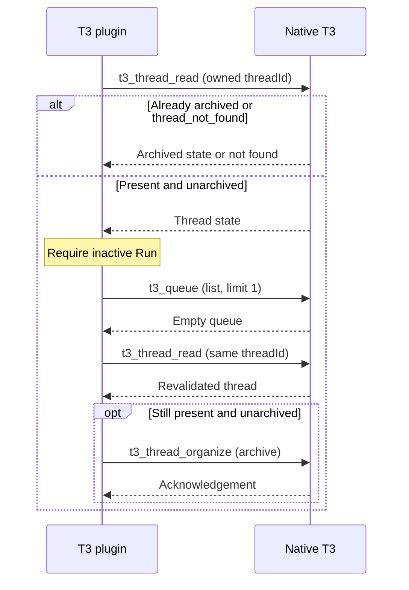
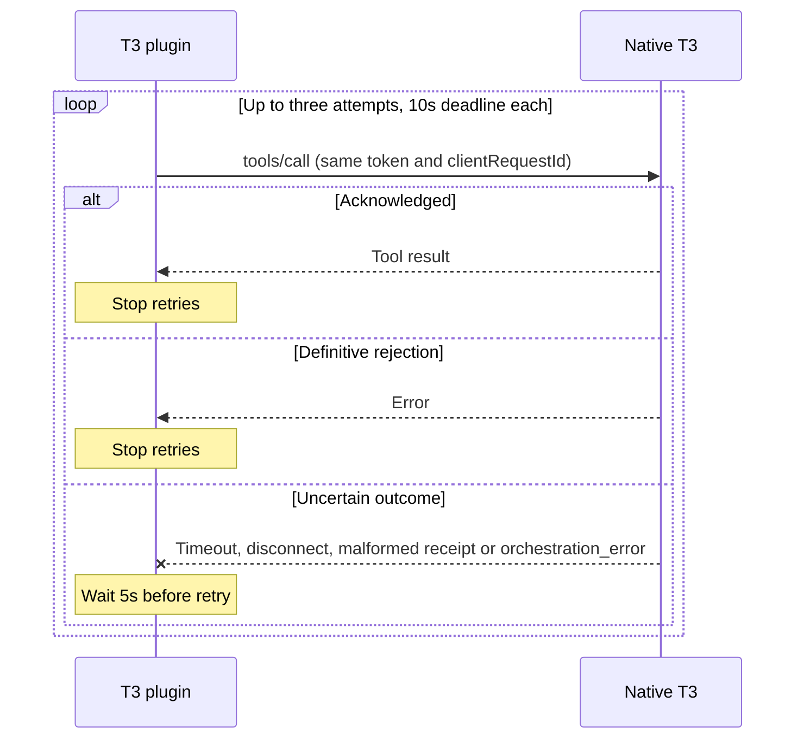

# T3 Code protocol

Native interfaces used by Runner with [T3 Code](https://github.com/pingdotgg/t3code) v0.1.11.

## MCP

[Tool contracts](https://github.com/pingdotgg/t3code/blob/main/packages/contracts/src/orchestratorMcp.ts): Streamable HTTP JSON-RPC, default endpoint `http://127.0.0.1:3773/mcp`. OAuth authorization code with PKCE; scopes `orchestration:read` and `orchestration:operate`. Tool responses use `structuredContent` or JSON in a text result.

| Tool | Parameters used | Purpose |
| --- | --- | --- |
| `orchestrator_capabilities` | Current calling thread | Invoking thread and inherited provider/model/options |
| `t3_project_read` | `projectId` | Project workspace root |
| `t3_project_list` | `limit: 1` | Authorization check |
| `t3_thread_read` | `threadId` | Thread identity, Project, Worktree and Run status |
| `t3_thread_read` | `threadId`, `view: "messages"`, `runLimit: 50`, optional `beforePosition`, `itemId`, `textOffset` | Observe Runs and read assistant replies |
| `t3_thread_launch` | `projectId`, `title`, `modelSelection`, `workspaceStrategy`, `clientRequestId` | Create an idle task thread |
| `t3_thread_send` | `threadId`, `message`, `mode: "queue"`, `clientRequestId` | Queue Assignment, recovery or diagnostic prompts |
| `t3_queue` | `threadId`, `action: "list"`, `limit: 1` | Check for queued turns |
| `t3_thread_organize` | `threadId`, `action: "unarchive"` or `"archive"` | Reopen or archive threads |
| `t3_thread_update` | `threadId`, `action: "rename"`, `title` | Rename threads |

- Create with `modelSelection: {instanceId, model, options: [{id, value}]}` and `workspaceStrategy: {type: "existing_worktree", worktreePath: cwd}`.
- Resume/archive require `activeRunId: null`, an inactive status (`idle`, `completed`, `failed`, `cancelled`, `interrupted`, `rolled_back`) and an empty queue (`items: []`, `nextCursor: null`).

## Terminal RPC

[Native RPC contract](https://github.com/pingdotgg/t3code/blob/main/packages/contracts/src/rpc.ts): JSON over WebSocket. Requests use `{_tag: "Request", id, tag, payload, headers}`; success is a correlated `Exit` containing `Success`.

| Interface | Parameters used | Purpose |
| --- | --- | --- |
| `t3 thread show` | Current thread ID | Verify local thread |
| `t3 auth session issue` | `terminal:operate`, TTL 5m | Terminal session credential |
| `POST /api/auth/websocket-ticket/rpc` | Bearer credential | WebSocket ticket |
| `terminal.open` | `threadId`, new `terminalId`, `cwd`, `stopOnSettle: false` | Open Runner terminal |
| `terminal.write` | `threadId`, `terminalId`, Runner command plus Enter | Start Runner |

## Interaction sequences

### Authorize Runner

### Launch Runner from the companion Skill

### Create a task thread and submit an Assignment

### Observe a task thread

### Resume a native thread

### Archive a task thread

### Retry uncertain create/send requests

